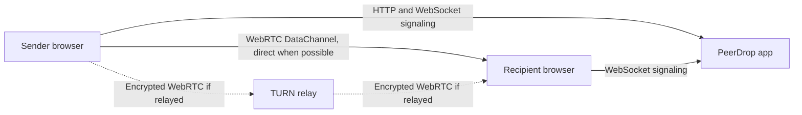
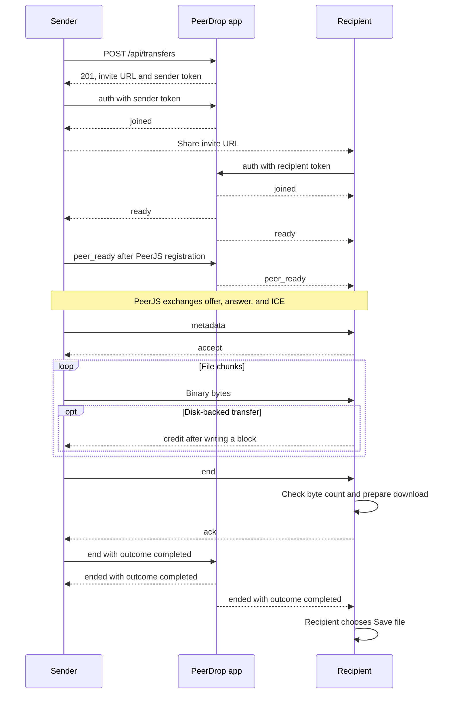

# PeerDrop file transfer protocol

PeerDrop uses one invite, one sender, one recipient, and one file per session. Fastify coordinates the invite and connection. The browsers exchange file data over a reliable, ordered WebRTC DataChannel. PeerDrop adapts FilePizza's in-memory channel repository and PeerJS setup and defines its own transfer messages. [FilePizza protocol guide](https://github.com/kern/filepizza/blob/main/docs/file-transfer-protocol.md) · [PeerDrop's FilePizza adaptations](filepizza.md)

## Architecture



The app server stores temporary session state and forwards connection messages. It accepts no file uploads. TURN can relay the same encrypted WebRTC traffic if configured and needed. The browser uses the same transfer messages on either path.

## Connect the browsers

1. The sender selects a file and sends an empty `POST /api/transfers`. The app returns `sessionId`, `senderToken`, `inviteUrl`, and `expiresAt`. The invite contains the recipient's token in the URL fragment.
2. Each browser opens the control WebSocket at `/ws/signaling/<sessionId>` and sends `auth` with its own token. The app replies `joined`. The recipient's browser clears the fragment after that reply.
3. When both roles have joined, the app sends `ready` with WebRTC settings, separate PeerJS credentials, and a shared transfer key. The sender registers with PeerJS and sends `peer_ready` over the control socket. The app forwards that event to the recipient.
4. Once the recipient registers with PeerJS and receives `peer_ready`, it sends the WebRTC offer. The sender answers. PeerJS exchanges ICE candidates so the browsers can choose a route. The sender checks the transfer key before using the `peerdrop-file` DataChannel. [HTTP and WebSocket contracts](api.md)

## DataChannel messages

Control messages are JSON text with a `type` and the same `transferId` established by `metadata`. File chunks are separate binary frames. The reliable, ordered channel preserves their sequence.

| Message or frame | Direction | Fields and behavior |
| --- | --- | --- |
| `metadata` | Sender → recipient | `name`, `size` in bytes, `mime`, and `flowControl: true` from current senders. The recipient validates the offer and shows the filename and size. |
| `accept` | Recipient → sender | Authorizes sending. Includes `window: 1048576` when the recipient writes a large file to temporary storage. |
| `decline` | Recipient → sender | Refuses the offer before the sender reads the file. |
| Binary chunk | Sender → recipient | Raw bytes from `File.slice()`. Each frame carries up to 16 KiB, or less if the negotiated message size is smaller. |
| `credit` | Recipient → sender | `bytes` is the cumulative count written to temporary storage. Used with disk-backed transfers. |
| `end` | Sender → recipient | Marks the end of file data. An empty file sends this immediately after acceptance. |
| `ack` | Recipient → sender | Confirms the expected byte count arrived and the complete download is ready. |
| `cancel` | Either direction | Stops a transfer after the DataChannel has opened and metadata is available. Cancellation also goes through the control WebSocket. |

### Successful transfer



The sender pauses when the DataChannel queues 512 KiB and resumes when the queue drops to 128 KiB. The recipient uses memory for files up to 32 MiB. For larger files it writes to browser-managed temporary storage and sends credit as bytes are written. At most 1 MiB can be sent ahead of credited bytes in that mode. **Delivered** means the recipient's browser acknowledged the complete file. The recipient saves a copy separately.

## Decline, cancel, or expiry

- **Decline.** The recipient declines the offer and reports the outcome over the control WebSocket. The app closes the session and broadcasts `ended`.
- **Cancel or disconnect.** Either participant can cancel through the control WebSocket. Closing a tab can interrupt an unfinished transfer. The recipient clears partial data, and the sender can create a fresh invite.
- **Expiry.** An unused invite expires after 10 minutes by default. Once both roles join, a separate two-hour transfer deadline applies by default. A completed, cancelled, expired, or failed session requires a fresh link for another attempt.

## Example exchange

For a 40 KiB PDF on a connection that supports 16 KiB frames, the sender sends two full-size frames and one 8 KiB frame. `T` stands for the same transfer UUID in each JSON message.

```text
Sender    → Recipient  {"type":"metadata","transferId":"T","name":"notes.pdf","size":40960,"mime":"application/pdf","flowControl":true}
Recipient → Sender     {"type":"accept","transferId":"T"}
Sender    → Recipient  [16384 bytes] [16384 bytes] [8192 bytes]
Sender    → Recipient  {"type":"end","transferId":"T"}
Recipient → Sender     {"type":"ack","transferId":"T"}
```

See [browser connection setup](../dist/connection.js), [DataChannel implementation](../dist/channel.js), and the [API reference](api.md) for implementation details.
